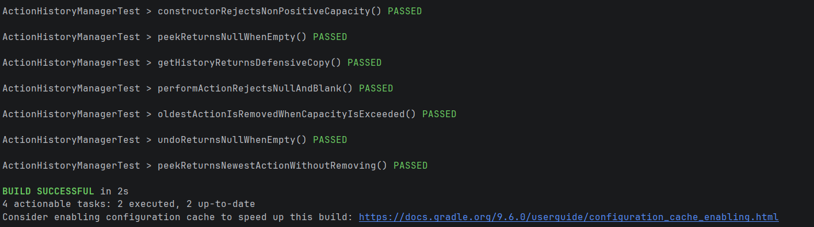
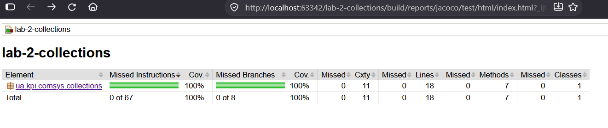

# Лабораторна робота №2 (Gradle & Java Collections Framework )

## Опис проєкту

Було реалізовано менеджер історії дій з обмеженою ємністю з використанням Java Collections Framework.
Основний функціонал зосереджено в класі `ActionHistoryManager`, який зберігає історію у вигляді черги `Deque<String>` (реалізація `ArrayDeque`): найновіша дія додається на початок, а при перевищенні максимальної ємності найстаріша дія автоматично видаляється з кінця.
Клас дозволяє додавати дії (`performAction`), скасовувати останню дію за принципом LIFO (`undo`), переглядати її без видалення (`peekRecentAction`), отримувати копію історії від найновішої до найстарішої дії (`getHistory`) та повністю очищати її (`clear`).
Для некоректних даних (ємність менша або дорівнює нулю, `null`, порожній чи пробільний рядок замість дії) викидається `IllegalArgumentException`, а для порожньої історії методи `undo` і `peekRecentAction` повертають `null`.
Залежностями в проєкті керує `Gradle` з використанням Version Catalog (`libs.versions.toml`).
Також написано юніт-тести на `JUnit 5`, які перевіряють усі сценарії поведінки програми, а покриття тестами контролюється за допомогою `JaCoCo`.

## Розрахунок варіанта

$$V = 4 \bmod 3 = 1$$

**Варіант $V = 1$:** Менеджер історії дій з обмеженням ємності

## Інструкція із запуску та тестування

> Для збірки проєкту та виконання тестів потрібна встановлена JDK 17+

Запуск повної збірки проєкту:

```bash
./gradlew build
```

Запуск юніт-тестів (після них автоматично формується звіт JaCoCo):

```bash
./gradlew test
```

Звіт про покриття тестами відкривається у браузері за шляхом `build/reports/jacoco/test/html/index.html`.

Результат знизу:



## Покриття тестами


Покриття перевірялось за допомогою `JaCoCo`. Клас `ActionHistoryManager` покритий юніт-тестами повністю:

* Instructions: 100% (0 із 67 пропущено)
* Branches: 100% (0 із 8 пропущено)
* Lines: 100% (0 із 18 пропущено)
* Methods: 100% (7 із 7 покрито)

Звіт формується автоматично після виконання `./gradlew test` і доступний у `build/reports/jacoco/test/html/index.html`.
